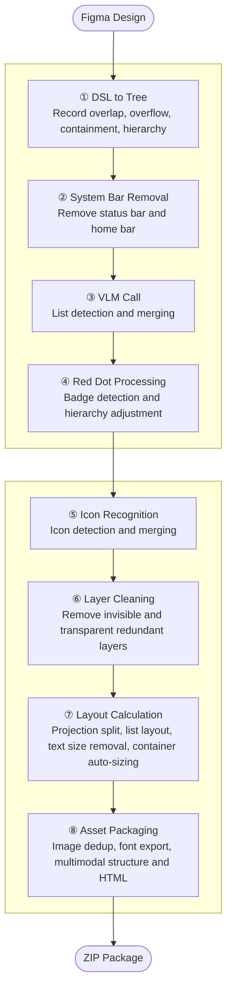
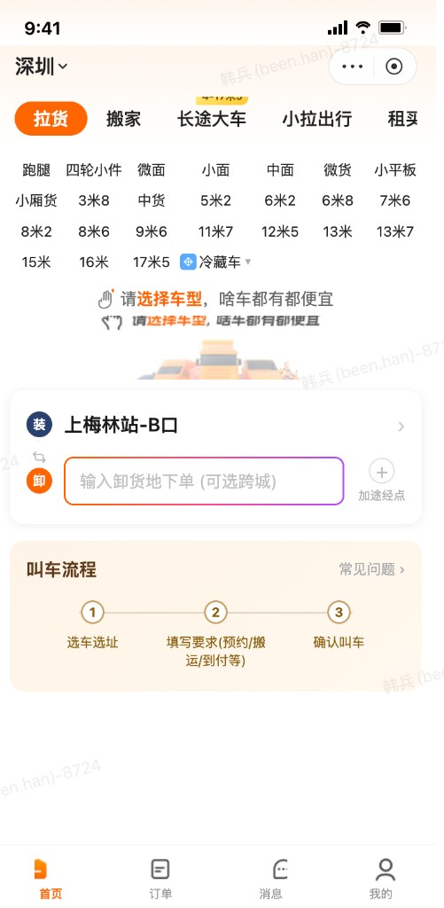
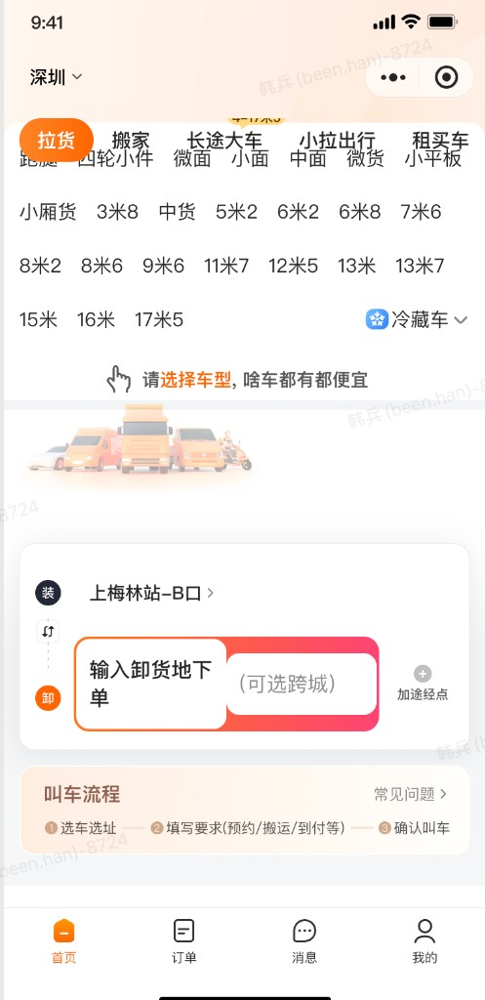
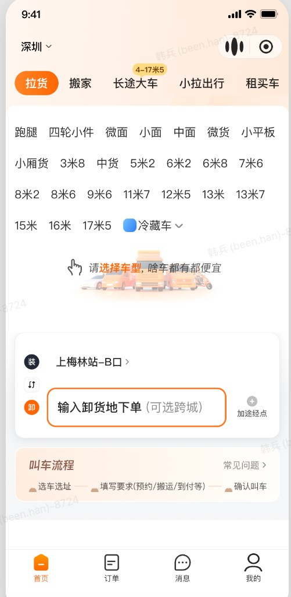
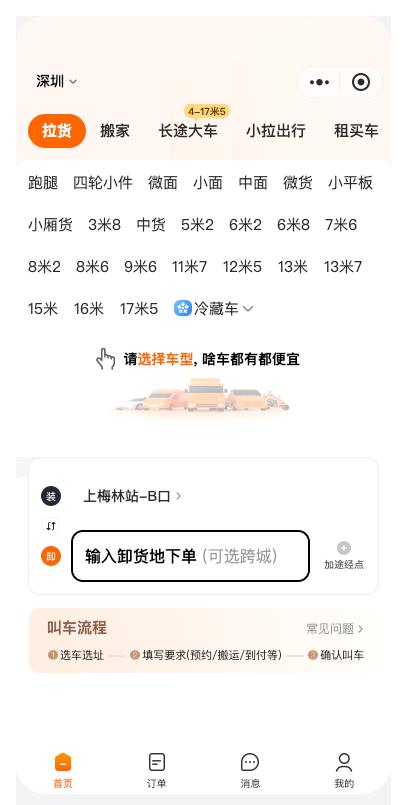

# Huolala Figma MCP

[](LICENSE)
[](#)
[](https://www.python.org/)
[](#)
[](https://gofastmcp.com/)

[English](./README.md) | [简体中文](./README_CN.md)

---

## Introduction

&emsp;&emsp;**Huolala Figma MCP** (`huolala-figma-mcp`) is Huolala's in-house MCP service that automatically converts **Figma designs** into high-fidelity UI code. Built on [FastMCP](https://gofastmcp.com/), it exposes MCP tools to AI clients (such as Cursor and Qorder). After invocation, clients receive a ZIP package containing `index.html`, sliced images, fonts, and other assets, which can then be further converted by an LLM into target platform code (HTML, React, Vue, Objective-C, Swift, Kotlin, React Native, and more).

- **High fidelity**: Cleans redundant layers and controls; recognizes red-dot badges, system bars, and home bars
- **Complete layout capabilities**: Supports distributed alignment, center alignment, linear layout, overlapping layout, list detection, automatic text width/height removal, and more — producing more usable code
- **Extensible**: DSL processing uses a processor registry plus priority pipeline; steps can be enabled or disabled as needed. Custom Skills are also supported to tailor the LLM workflow

## Core Workflow

&emsp;&emsp;The core flow is: **Figma API fetch → intermediate DSL → pipeline layout & visual processing → export ZIP**. A rules engine handles structured layout and asset processing; optional VLM multimodal capabilities support complex UI recognition.



| Step | Description |
|:----:|-------------|
| ① DSL to Tree | Record cross-overlap, overflow, containment, and hierarchy |
| ② System Bar Removal | Remove status bar and Home Bar |
| ③ VLM Call | List detection and merging (optional, disabled by default) |
| ④ Red Dot Processing | Red-dot badge detection and hierarchy adjustment |
| ⑤ Icon Recognition | Icon detection and merging |
| ⑥ Layer Cleaning | Remove invisible and transparent redundant layers |
| ⑦ Layout Calculation | Projection split, list layout, text width/height removal, container auto-sizing |
| ⑧ Asset Packaging | Image deduplication, font export, multimodal structure and HTML |

## Comparison

&emsp;&emsp;Below is a comparison of common Design-to-Code approaches (fidelity, implementation, and typical issues):

| Solution | Open Source | Fidelity | Visual Example / Issues | Implementation | Limitations |
|----------|:-----------:|:--------:|---------------------------|----------------|-------------|
| Image Input + Multimodal LLM | Partially open source | Low |  | Uses multimodal LLMs to recognize UI layout and details from images | Cannot perceive sub-pixel differences; unable to accurately restore design attributes |
| Open Source Figma Context MCP | Open source | High |  | 1. Calls RESTful API, extracts key info, merges identical attributes, then sends to LLM for transcoding 2. Uses `get_image` for asset slicing | Does not integrate multimodal LLMs; poor handling of repeating component grouping |
| Figma Official MCP | Not open source | High |  | 1. Reads design JSON 2. Reads design screenshot and calls multimodal LLM 3. Merges both data sources via LLM | Poor fidelity on complex pages |
| Huolala In-house MCP | Open source | Highest |  | 1. Image processing and CV to clean designs and remove redundant elements/layers 2. In-house icon recognition for precise slicing 3. Custom Skills to fuse multimodal LLM output with DSL for controllable workflow 4. Custom layout algorithms for developer-friendly code | Complex technical approach |

## Guide

### MCP Service Setup

1) Clone the repository locally.

2) Create a virtual environment and install dependencies:
- Python 3.11 or higher

```bash
python3.11 -m venv venv
source venv/bin/activate
pip install -e .
```

3) Configure the Figma token:

```bash
cp .env.example .env
# Edit .env and set MDAP_FIGMA_TOKEN
```

- Figma Personal Access Token ([Figma → Settings → Security](https://www.figma.com/settings))

4) Start the service:

```bash
python -m mdap_u2c --port=10001
```

5) Configure the MCP client with the service URL, for example:

```json
"ui2code-local": {
  "url": "http://localhost:10001/mcp",
  "transport": "http"
}
```

Prompt example: Call the `figma_to_code_package` tool with a Figma design URL to generate an HTML page with high visual fidelity.

### Optional: Prompt Templates

&emsp;&emsp;The [`assets/prompts/`](./assets/prompts/) directory provides two prompt templates to standardize Agent calls to MCP tools and subsequent transcoding workflows:

| Template File | MCP Prompt Name | Purpose |
|---------------|-----------------|---------|
| [`get_figma_property.md`](./assets/prompts/get_figma_property.md) | `get_figma_property` | Extract Figma design properties: read text, styles, etc. — suitable for partial UI updates |
| [`ui2code_with_skills.md`](./assets/prompts/ui2code_with_skills.md) | `ui2code_with_skills` | Full UI-to-code workflow: fetch ZIP, adjust repeating components, load Skills by target platform, and generate code |

**IDEs with MCP Prompts support (e.g. Cursor)**

&emsp;&emsp;After starting the MCP service and configuring the client, invoke the prompts directly in chat with `/`:

```
/get_figma_property
/ui2code_with_skills
```

&emsp;&emsp;Then fill in the Figma URL, target language, and other parameters as prompted.

**IDEs without MCP Prompts support**

&emsp;&emsp;Adapt the template content to a format your IDE supports, for example:

- **Skills**: Copy or link `assets/prompts/*.md` into your IDE's Skills directory and let the Agent load them on demand
- **Commands / Rules**: Split templates into fixed commands or project rules

&emsp;&emsp;Template source files match the server-side MCP Prompt registration. After editing files under `assets/prompts/`, restart the service to sync changes to MCP Prompts.

### Optional: VLM Multimodal

Disabled by default. When enabled, the DSL pipeline calls multimodal models to recognize UI structure. If not configured, the prompt templates will automatically use the multimodal LLM available in the smart IDE via subagent.

```bash
export MDAP_VLM_PROVIDER=openai
export MDAP_VLM_API_KEY=sk-...
export MDAP_VLM_MODEL=gpt-4o
export MDAP_VLM_BASE_URL=https://api.openai.com/v1
```

### Optional: Automated Comparison Testing

Batch-run Figma links and generate HTML similarity reports (requires Playwright):

```bash
pip install ".[ui2code-test]"
playwright install chromium
python tests/ui2code_auto_test.py
```

Test URLs are configured in `tests/test_url_list.txt`.

## Project Modules

```
huolala-figma-mcp/
├── src/mdap_u2c/          # Main source code
│   ├── figma/             # Figma integration
│   ├── dsl_processors/    # DSL processing pipeline
│   ├── services/          # Business orchestration
│   ├── server/            # MCP / HTTP service
│   └── config/            # Configuration
├── assets/                # Fonts, CV templates, Skills, prompts
├── tests/                 # Comparison test tools
└── pyproject.toml
```

- **Figma Integration Layer** (`src/mdap_u2c/figma/`)

  Figma API client, node parsing, and DSL component conversion — maps design nodes to the internal DSL model.

- **DSL Processing Layer** (`src/mdap_u2c/dsl_processors/`)

  Pipeline with auto-registered processors: image merging, DSL-to-tree, system bar cropping, red-dot marking, projection grouping, layout calculation, and more.

- **Service Orchestration Layer** (`src/mdap_u2c/services/`)

  - `FigmaService`: Figma → DSL
  - `UI2CodeService`: Single entry point for the three-layer flow (Figma → DSL → processing → ZIP)
  - `ExportService`: Export DSL to ZIP package (HTML + assets)

- **MCP / HTTP Service Layer** (`src/mdap_u2c/server/`)

  FastMCP instance, MCP tools/resources/prompt registration, and health-check REST routes.

- **Assets & Skills** (`assets/`)

  Fonts, CV template images, YOLO badge models, platform conversion Skill prompts, and more.

Tool name: **`figma_to_code_package`**

| Parameter | Description |
|-----------|-------------|
| `figma_url` | Full Figma design URL; must include `/file/{key}/` or `/design/{key}/` and `?node-id=` |
| `image_scale` | Image scale list, e.g. `[3, 2]`; values 1–4 |
| `target_platform` | Target platform: `h5` / `vue` / `react` / `react native` / `ios` / `android` |

Response example:

```json
{
  "zip_url": "http://localhost:10001/...",
  "metadata": { "...": "..." },
  "message": "zip_url 可直接下载"
}
```

Contents after extracting the ZIP:

| File / Directory | Description |
|------------------|-------------|
| `index.html` | Rule-based Web code for LLM secondary conversion |
| `images/` | Icons and sliced image assets |
| `fonts/` | Font files |
| `dsl.json` | Intermediate DSL data |
| `design.png` |Origin design screenshot image|
| `vlm_result.json` | Multimodal LLM result; only present when configured in the pipeline |

## License

&emsp;&emsp;Licensed under the [Apache License 2.0](LICENSE).
