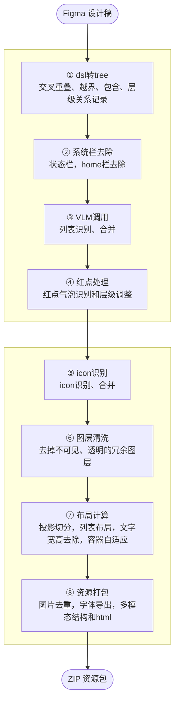
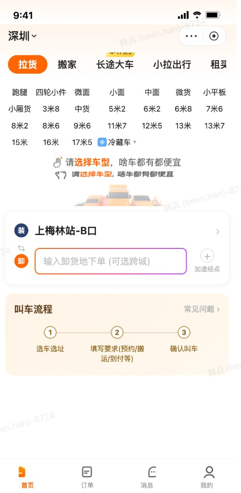
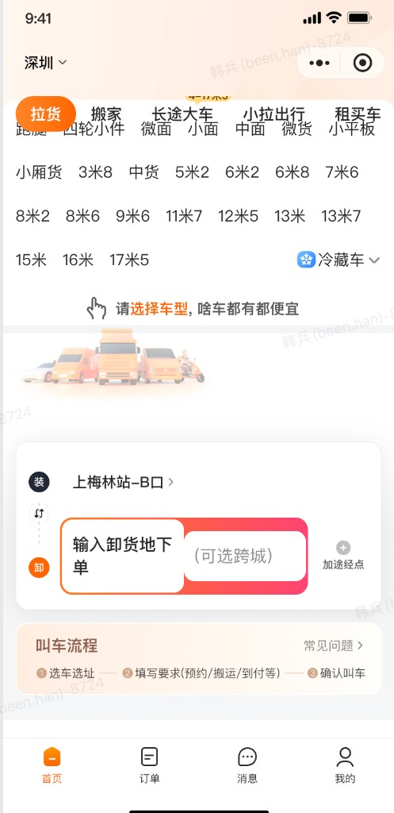
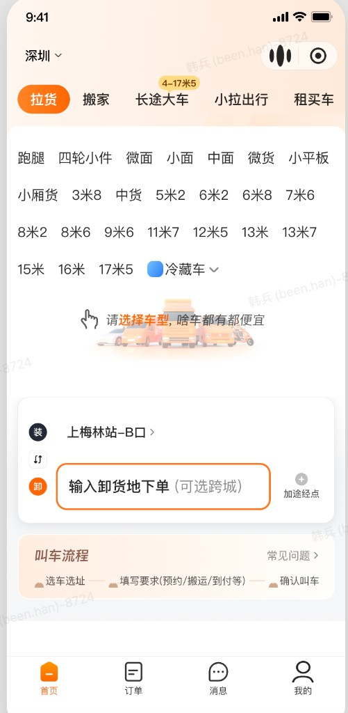
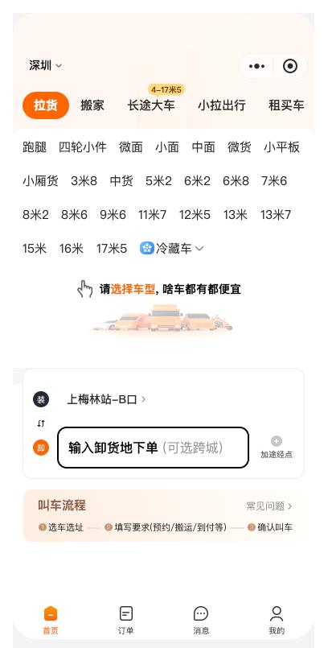

# Huolala Figma MCP

[](LICENSE)
[](#)
[](https://www.python.org/)
[](#)
[](https://gofastmcp.com/)

[English](./README.md) | [简体中文](./README_CN.md)

---

## 介绍

&emsp;&emsp;**Huolala Figma MCP**（`huolala-figma-mcp`）是货拉拉自研的将 **Figma 设计稿** 自动转换为高还原度的UI代码的 MCP 服务。服务基于 [FastMCP](https://gofastmcp.com/) 对外暴露 MCP 工具，AI 客户端（如 Cursor、Qorder）调用后可获得包含 `index.html`、切图、字体等资源的 ZIP 包，再借助 LLM 进一步转换为目标平台代码（HTML、React、Vue、ObjectC、Swift、Kotlin、React Native等等）。
- **还原度高**：对冗余图层和控件做了清洗，对红点气泡、系统栏、homebar做了识别
- **布局能力完备**：做了分散对齐、居中对齐、线形布局、重叠布局、列表识别、文字宽高自动去除识别等，生成的代码可用性更高
- **可扩展**：DSL 加工采用处理器注册 + 优先级流水线，可按需启用/禁用步骤。此外还能自定义SKILLS，自己定制大模型运行流程。


## 核心流程
&emsp;&emsp;核心流程：**Figma API 拉取节点 → 中间 DSL 表示 → Pipeline 布局与视觉加工 → 导出 ZIP**。规则引擎负责结构化布局与资源处理，可选 VLM 多模态能力用于复杂 UI 识别。


| 步骤 | 说明 |
|:----:|------|
| ① dsl转tree | 记录交叉重叠、越界、包含与层级关系 |
| ② 系统栏去除 | 去除状态栏、Home Bar |
| ③ VLM调用 | 列表识别与合并（可选，默认关闭） |
| ④ 红点处理 | 红点气泡识别与层级调整 |
| ⑤ icon识别 | Icon 识别与合并 |
| ⑥ 图层清洗 | 去除不可见、透明的冗余图层 |
| ⑦ 布局计算 | 投影切分、列表布局、文字宽高去除、容器自适应 |
| ⑧ 资源打包 | 图片去重、字体导出、多模态结构与 HTML |

## 比较

&emsp;&emsp;以下为常见 Design-to-Code 方案对比（含还原度、实现原理与典型问题）：

| 方案名称 | 开源情况 | 还原度 | 视觉示例 / 问题 | 实现原理 | 缺点  |
|----------|----------|:------:|-----------------|----------|-------------|
| 图片输入 + 多模态大模型 | 部分开源 | 比较低 |  | 利用多模态大模型识别图片中的 UI 布局和细节。 | 多模态大模型无法感知几个像素点细微差异，无法精确还原设计稿属性 |
| 开源 Figma Context MCP  | 开源 | 高 |  | 1.调用 RESTful API 后，提取关键信息并将相同属性合并，送大模型转码 2.get_image获取切图| 没有融合多模态大模型，对循环组件分组处理不好 |
| Figma 官方 MCP | 不开源 | 高 |  | 1.先读取设计稿 JSON 信息 2.读取设计稿截图，调用多模态大模型3.利用大模型将2份数据融合 | 复杂页面还原度差 |
| 货拉拉自研MCP | 开源 | 最高 |  | 1.先采用图像处理、计算机视觉技术对设计稿做清洗，去掉冗余元素和图层2.自研icon识别算法，精确切图3.通过自定义skills融合多模态大模型和结果和DSL，过程更可控4.自定义布局识别算法，让生成的代码更贴合开发需要 | 技术方案复杂|

## 指引
### MCP服务使用
1) 克隆仓库到本地。

2) 创建虚拟环境并安装依赖：
- Python 3.11 或更高版本

```bash
python3.11 -m venv venv
source venv/bin/activate
pip install -e .
```
3) 配置figma token：

```bash
cp .env.example .env
# 编辑 .env，填入 MDAP_FIGMA_TOKEN
```
- Figma Personal Access Token（[Figma → Settings → Security](https://www.figma.com/settings) 创建）
4) 启动服务：

```bash
python -m mdap_u2c --port=10001
```

5) 在 MCP 客户端中配置服务地址，例如：

```json
"ui2code-local": {
  "url": "http://localhost:10001/mcp",
  "transport": "http"
}
```

提示词示例：调用工具 `figma_to_code_package` 将 Figma 链接转成 HTML 页面，要求页面高度还原。

### 可选：提示词模版使用

&emsp;&emsp;[`assets/prompts/`](./assets/prompts/) 目录提供了两个提示词模版，用于规范 Agent 调用 MCP 工具与后续转码流程：

| 模版文件 | MCP Prompt 名称 | 用途 |
|----------|-----------------|------|
| [`get_figma_property.md`](./assets/prompts/get_figma_property.md) | `get_figma_property` | 获取 Figma 设计属性： 读取文字与样式等，适合局部UI改版 |
| [`ui2code_with_skills.md`](./assets/prompts/ui2code_with_skills.md) | `ui2code_with_skills` | 完整 UI 转码流程：获取 ZIP、循环组件调整、按目标平台加载 Skills 并生成代码 |

**支持 MCP Prompts 的 IDE（如 Cursor）**

&emsp;&emsp;启动 MCP 服务并完成客户端配置后，可在对话中通过 `/` 直接唤起上述 Prompt，例如：

```
/get_figma_property
/ui2code_with_skills
```

&emsp;&emsp;唤起后按提示填入 Figma URL、目标语言等参数即可。

**不支持 MCP Prompts 的 IDE**

&emsp;&emsp;可将模版内容改为 IDE 支持的形态使用，例如：

- **Skills**：将 `assets/prompts/*.md` 内容复制或链接到 IDE 的 Skills 目录，由 Agent 按需加载
- **Commands / Rules**：将模版拆成固定指令或项目规则

&emsp;&emsp;模版源文件与服务端 MCP Prompt 注册内容一致，修改 `assets/prompts/` 下文件后重启服务即可同步到 MCP Prompt。

### 可选：VLM 多模态

默认关闭。启用后可在 DSL 流水线中调用多模态模型识别 UI 结构，不配置的话提示词中会自动通过subagent使用智能IDE调用的多模态大模型处理。

```bash
export MDAP_VLM_PROVIDER=openai
export MDAP_VLM_API_KEY=sk-...
export MDAP_VLM_MODEL=gpt-4o
export MDAP_VLM_BASE_URL=https://api.openai.com/v1
```

### 可选：自动化对比测试

批量跑 Figma 链接、生成 HTML 相似度报告（需 Playwright）：

```bash
pip install ".[ui2code-test]"
playwright install chromium
python tests/ui2code_auto_test.py
```

测试 URL 列表配置在 `tests/test_url_list.txt`。

## 项目模块

```
huolala-figma-mcp/
├── src/mdap_u2c/          # 主代码
│   ├── figma/             # Figma 集成
│   ├── dsl_processors/    # DSL 加工 Pipeline
│   ├── services/          # 业务编排
│   ├── server/            # MCP / HTTP 服务
│   └── config/            # 配置管理
├── assets/                # 字体、CV 模板、Skills，prompts
├── tests/                 # 对比测试工具
└── pyproject.toml
```

- **Figma 集成层**（`src/mdap_u2c/figma/`）

  Figma API 客户端、节点解析与 DSL 组件转换，将设计稿节点映射为内部 DSL 模型。

- **DSL 加工层**（`src/mdap_u2c/dsl_processors/`）

  Pipeline + 自动注册处理器。包含图片合并、DSL 转树、系统栏裁剪、红点标记、投影分组、布局计算等步骤。

- **服务编排层**（`src/mdap_u2c/services/`）

  - `FigmaService`：Figma → DSL
  - `UI2CodeService`：三层流程唯一入口（Figma → DSL → 加工 → ZIP）
  - `ExportService`：DSL 导出 ZIP 包（HTML + 资源）

- **MCP / HTTP 服务层**（`src/mdap_u2c/server/`）

  FastMCP 实例、MCP 工具/资源/Prompt 注册，以及健康检查等 REST 路由。

- **资源与技能**（`assets/`）

  字体、CV 模板图、YOLO 气泡模型、各平台转换 Skill 提示词等。


工具名：**`figma_to_code_package`**

| 参数名 | 说明 |
|--------|------|
| `figma_url` | Figma 设计稿完整链接，需含 `/file/{key}/` 或 `/design/{key}/` 及 `?node-id=` |
| `image_scale` | 切图倍数列表，如 `[3, 2]`，取值范围 1–4 |
| `target_platform` | 目标平台：`h5` / `vue` / `react` / `react native` / `ios` / `android` |

返回示例：

```json
{
  "zip_url": "http://localhost:10001/...",
  "metadata": { "...": "..." },
  "message": "zip_url 可直接下载"
}
```

ZIP 解压后主要包含：

| 文件/目录 | 说明 |
|-----------|------|
| `index.html` | 基于规则转换的 Web 代码，供 LLM 二次转换 |
| `images/` | 图标与切图资源 |
| `fonts/` | 字体文件 |
| `dsl.json` | 中间 DSL 数据 |
| `design.png` | 原始设计稿截图 |
| `vlm_result.json` | 多模态大模型结果，需要流水线配置了才会有 |


## 许可证

&emsp;&emsp;采用 [Apache License 2.0](LICENSE) 协议。
